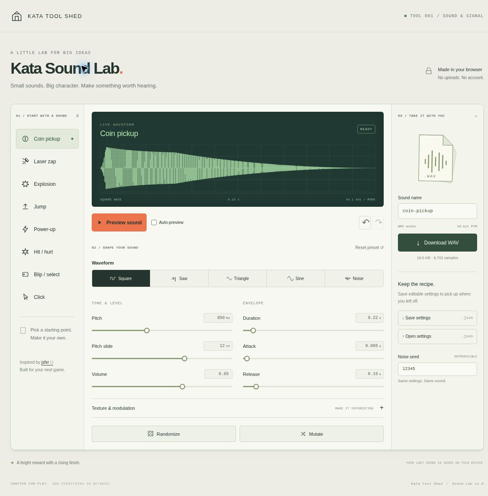

# Kata Sound Lab

**Small sounds. Big character.** A lightweight, original retro sound-effects workbench inspired by [jsfxr](https://sfxr.me/), and the first app prepared for **Kata Tool Shed**.



## Run locally

Node.js 18 or newer. No installation, runtime dependencies, bundler, or account is required.

```sh
npm start
```

Open **http://127.0.0.1:4173/** in a browser. Always test via this HTTP server, not by opening HTML as a `file://` URL. To use another port: `PORT=4180 npm start` (PowerShell: `$env:PORT=4180; npm start`). The server binds to loopback by default.

```sh
npm run check   # JavaScript syntax checks and automated tests
npm run build   # Static distribution in dist/
```

The static app can be hosted under a subdirectory. Assets use relative paths. Building does not publish or deploy anything.

## Make a sound

1. Pick Coin, Laser, Explosion, Jump, Power-up, Hit, Blip, or Click.
2. Choose Square, Saw, Triangle, Sine, or Noise. Adjust pitch, pitch slide, level, duration, attack, and release.
3. Open **Texture & modulation** for vibrato, punch, low-pass cutoff, and bit crunch.
4. Press **Preview sound**. Space also starts/stops playback when focus is outside interactive controls. Audio starts only after interaction. Enable Auto-preview if you want changes to play automatically.
5. Try **Randomize** for a new idea, **Mutate** for a nearby variation, or Undo/Redo to compare. Up to 40 changes are retained until the page reloads.
6. Name your sound and download a **44.1 kHz, mono, 16-bit PCM WAV**. Save the JSON settings as an editable recipe, then reopen them here later.

Noise is unpitched, so its pitch/slide/vibrato controls are disabled. The low-pass cutoff changes its color. Attack and release are shortened proportionally when they would overlap; duration remains the total sound length. Short mandatory endpoint ramps reduce clicks. Audio is bounded below full scale. Preview has an additional 0.7 gain for comfort; the WAV uses the chosen sound Volume without that extra preview attenuation. Start with low device volume, especially on headphones.

## Reproducibility and local data

Synthesis is procedural; no recorded samples or external assets are fetched. Noise uses an explicit integer seed. Matching settings and seed produce exactly matching samples in the same JavaScript runtime. JavaScript trigonometry can vary slightly across browser engines, so cross-engine binary identity is not guaranteed. Export a WAV when exact final bytes matter.

The latest sound is automatically stored in this browser's local storage. It is not cloud-synced, and clearing site data removes it. Export settings for a durable backup. Restricted browser storage is handled without blocking synthesis or export. Imported JSON is validated as data, never evaluated as code; malformed, unknown-version, or oversized settings leave the current sound unchanged.

Settings use the **Kata Sound Lab version 1** format. They are **not** jsfxr/sfxr preset files. There is no MP3/OGG export, cloud library, multi-track sequencer, or account system. The app has no service worker and does not promise offline availability after a hosted page is closed. The local server works without an internet connection.

## Screenshots and verification

- [Desktop screenshot](docs/screenshots/desktop.jpg)
- [Narrow-screen screenshot](docs/screenshots/mobile.jpg)
- [Screenshot provenance](docs/screenshots/manifest.json)
- [QA report](docs/QA.md)

Screenshots are genuine Chromium captures of the localhost app. The narrow layout was checked at a 500 CSS-pixel viewport, not on a physical phone. The test command reports current results; this README is not a guarantee that untested browsers pass.

## Project structure

- `src/synth.js`: pure deterministic synthesis, presets, settings validation, and WAV encoding.
- `src/app.js`: accessible UI, playback, waveform preview, history, persistence, and downloads.
- `server.mjs`: small loopback development server.
- `tests/`: engine safety/reproducibility and development-server tests.
- `app.json`: catalog metadata for Kata Tool Shed.

`app.json` currently marks this work **local-preview**. The repository and public app URL have not been created or published as part of this local build. The sibling hub changes should only add launch/source links once those destinations exist.

## Inspiration and license

The preset → tweak → preview → export workflow was researched at [sfxr.me](https://sfxr.me/) and the [jsfxr repository](https://github.com/chr15m/jsfxr). The reference project identifies its license as the [Unlicense](https://github.com/chr15m/jsfxr/blob/master/UNLICENSE). Thanks to DrPetter, Eric Fredricksen, and Chris McCormick for the sfxr/jsfxr tradition.

This is an independent implementation, not a fork, port, or claim of sound-for-sound compatibility. No jsfxr source, design assets, or audio samples were copied. Original project code and UI assets are provided under the [MIT License](LICENSE). The app imposes no additional restrictions on sound files you generate. It is not affiliated with or endorsed by the jsfxr maintainers.
